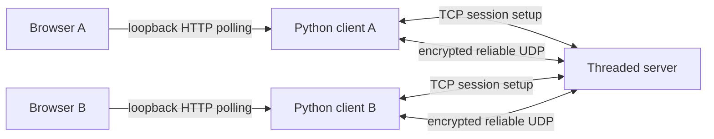
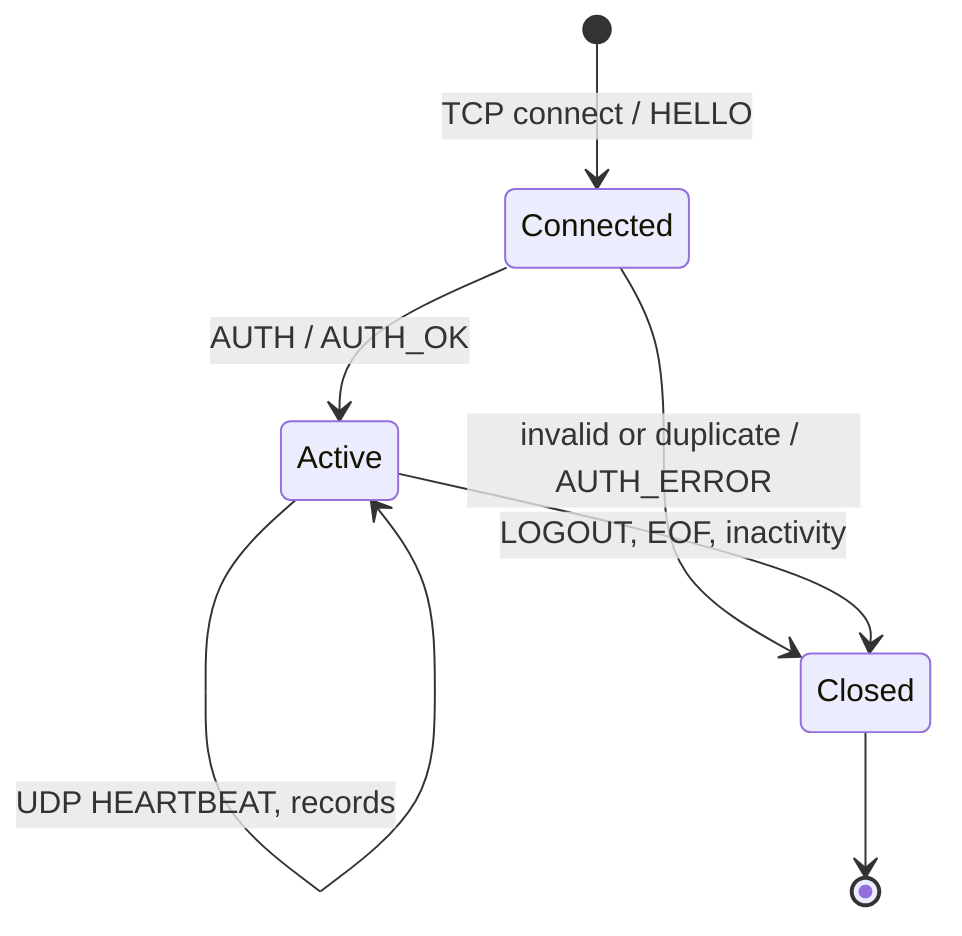
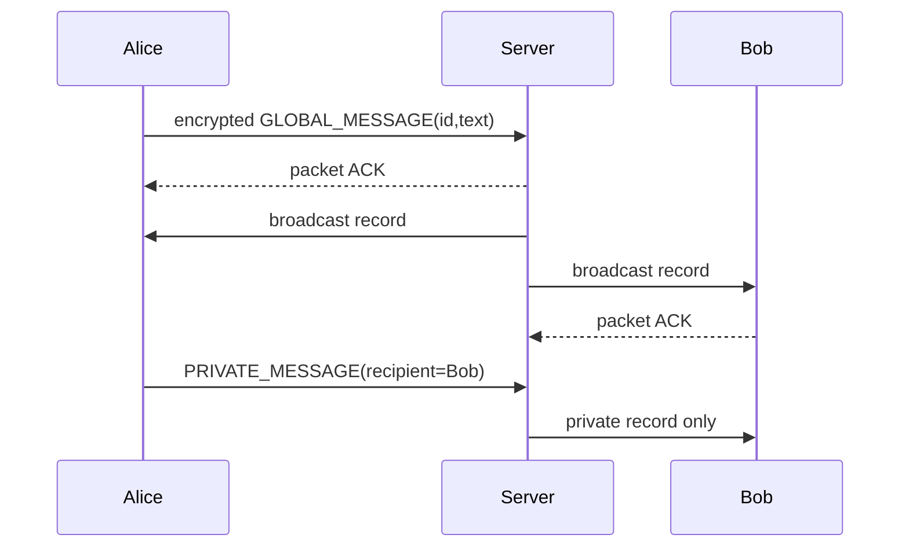
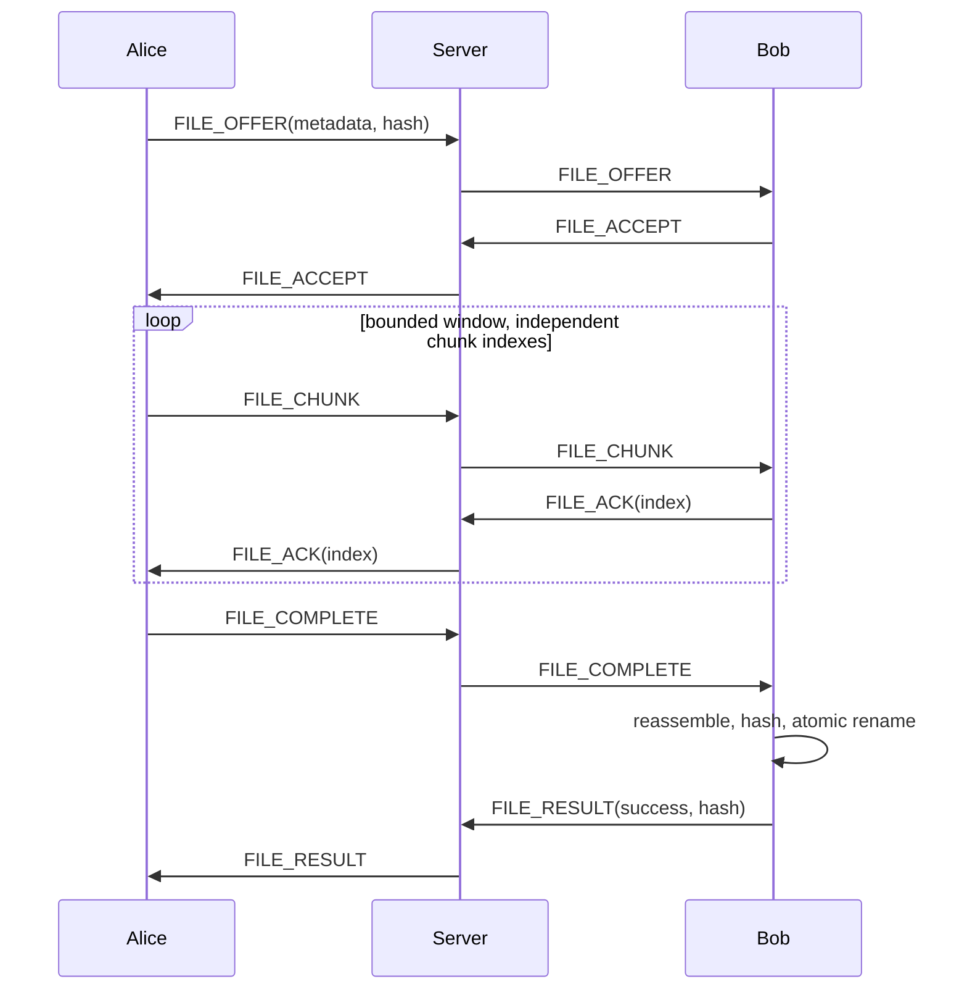

# Protocol and architecture decisions

The PDF's UDP streaming goal and milestone 6 take precedence over its general TCP-transfer example. Milestone 9 explicitly requests HTTP UI; HTTP is confined to a loopback standard-library bridge. No HTTP framework or WebSocket is used for distributed traffic.

## TCP control

A four-byte unsigned network-endian length precedes UTF-8 JSON, limited to 16384 bytes. Server sends HELLO with version 1; client sends AUTH with username, UDP port and hexadecimal X25519 public key. AUTH_OK carries a UUID session, server ephemeral public key and UDP port. AUTH_ERROR ends a rejected connection. Usernames match `[A-Za-z0-9_-]{1,24}` and must be unique among active sessions. This is ephemeral nickname admission, not password identity authentication. TCP EOF/logout removes the session. UDP inactivity expires it after 15 seconds by default. READY synchronizes presence once the client has installed its key.

## UDP wire format

Each datagram is at most 1200 bytes. Header uses `!2sB16sQ`: magic `NC` (2 bytes), kind (1 byte: DATA=0 or ACK=1), session UUID (16 bytes), monotonically increasing packet counter (8 bytes). The remaining bytes are AES-GCM ciphertext with its 16-byte authentication tag. Datagram boundaries provide length; the fixed magic identifies protocol version 1. Header is authenticated additional data. Nonce is the counter encoded into 12 big-endian bytes. Independent directional keys prevent nonce collisions between client and server. Retransmission resends exactly the same ciphertext. New packets, including ACKs, consume new counters.

DATA plaintext is a JSON record. ACK plaintext is an eight-byte unsigned packet counter. DATA records are deduplicated using a bounded 8192-counter replay window. ACK is sent only after the dispatch queue accepts a new record. Invalid, oversized, unknown-session, wrong-source, malformed or unauthenticated packets are discarded. ACK replays cannot create new application events.

Application types: READY, USER_LIST (username entries and monotonic snapshot revision), HEARTBEAT, GLOBAL_MESSAGE, PRIVATE_MESSAGE, ERROR, FILE_OFFER, FILE_ACCEPT, FILE_ACK, FILE_CHUNK, FILE_COMPLETE, FILE_RESULT. Messages carry UUID id, text and recipient; server stamps authenticated sender and timestamp. Offers carry id/name/size/SHA-256/recipient. Chunks carry id/index/base64 data/recipient. Completion and result carry id; results add success and computed hash. FILE_ACK carries chunk index for end-to-end receiver credits. Session and packet counters identify the hop; file UUID plus sender identifies an independent file stream.

## Reliability, ordering and flow control

Each authenticated peer owns a selective-repeat send window, initially four packets, capped at 32. Missing packet ACKs cause selective timeout retransmission with 150 ms initial RTO and exponential backoff capped at two seconds. Twelve retries exhaust the connection. Backlogs cap at 256 records; dispatch queue caps at 8192. File senders keep at most 16 chunks ahead of receiver FILE_ACK credits, avoiding unlimited server relay buffering. Chunks are 512 raw bytes to leave room for base64, JSON metadata, encryption and the fixed header below 1200 bytes. File progress counts unique received bytes. Files are streamed to disk at indexed offsets, not accumulated in memory.

A file can complete before its final chunks due to packet reordering: completion is remembered until all bytes arrive. Duplicate chunks do not count twice. Incomplete files expire after 45 seconds and `.part` files are removed. Finalization requires matching SHA-256 and atomic rename. File names are reduced to a basename and prefixed with a random transfer UUID. Maximum accepted file size is 1 GiB; browser uploads cap at 32 MiB.

Records are delivered to independent handlers as they arrive: no connection-wide reorder wait. File ordering uses indexed random-access writes. Chat is message-oriented and arrival-ordered; it does not guarantee sender order across lost packets. All streams share a congestion window and dispatch worker, so complete bandwidth isolation is not claimed. UDP removes TCP-style in-order head-of-line blocking but cannot remove finite queue or scheduling contention.

## Educational CUBIC-inspired congestion controller

On each ACK, the window grows using the larger of additive growth and `0.4*(elapsed-K)^3 + Wmax`, where `K=(0.3*Wmax/0.4)^(1/3)`. Timeout reduces the window by factor 0.7, minimum two, resets the epoch and records retransmissions. This demonstrates cubic recovery and loss response; it is not a complete standards-conformant CUBIC or BBR implementation. It lacks RTT estimation, pacing, fast recovery and TCP fairness guarantees. `peer.cwnd`, `peer.pending`, `peer.backlog` and `peer.retransmissions` expose metrics for inspection.

## Security and trust

X25519 ephemeral key agreement plus HKDF-SHA256 establishes a new 256-bit session secret. SHA-256 of secret plus distinct client/server labels yields separate AES-GCM traffic keys. Keys live only in memory and are never logged. Source IP and UDP port are bound at login. Encryption protects payload confidentiality and integrity against passive sniffing. Public headers expose session identifiers and traffic volume; TCP exposes usernames and public keys. No certificate or pinned server identity is used: an active man-in-the-middle can impersonate the server. The server decrypts routed data, so this is hop-by-hop encryption. Deploy only on a trusted LAN/VPN; do not expose to the Internet.

The HTTP bridge binds exclusively to 127.0.0.1, requires a random capability token in X-Token, verifies Host/Origin for API calls, rejects cross-origin requests and uses textContent for untrusted UI content. The token is printed in the URL fragment and removed from browser history after loading. Browser API events are session-scoped and bounded. Upload spools remain in the downloads directory for user inspection and can be deleted after transmission. Downloads are local files; no arbitrary file-read HTTP endpoint exists.
