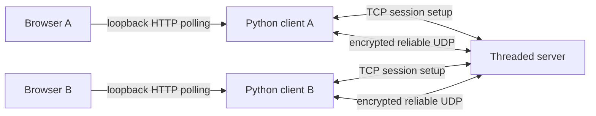
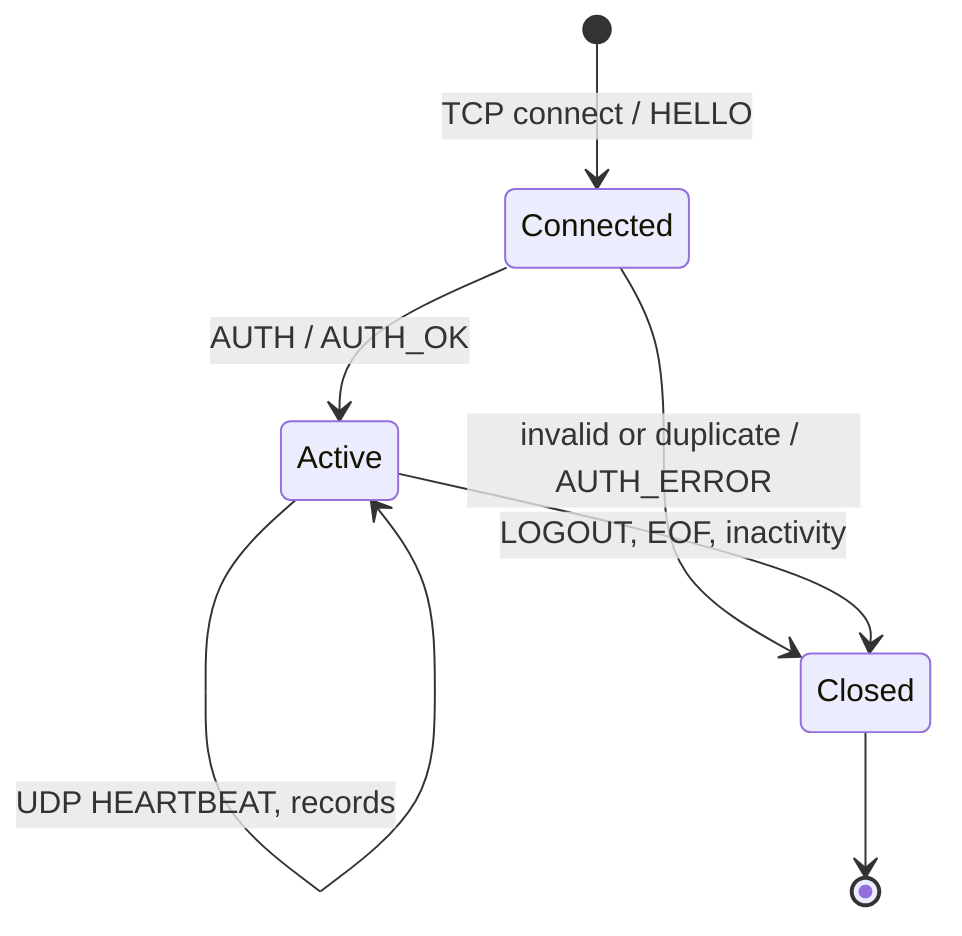
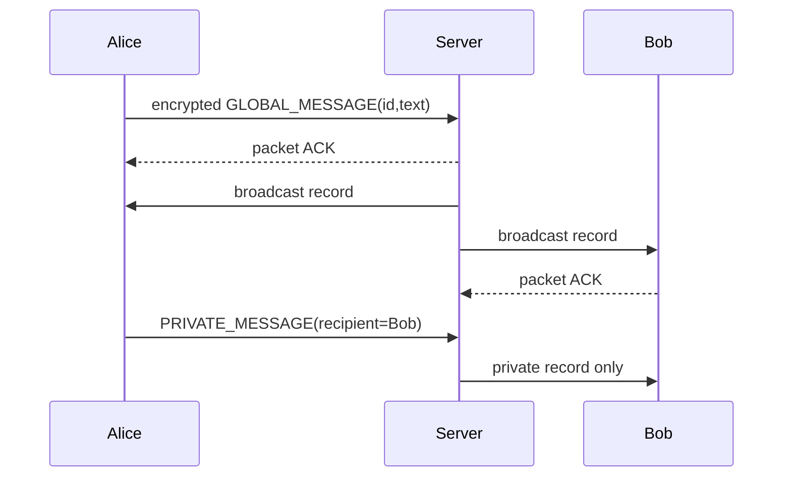
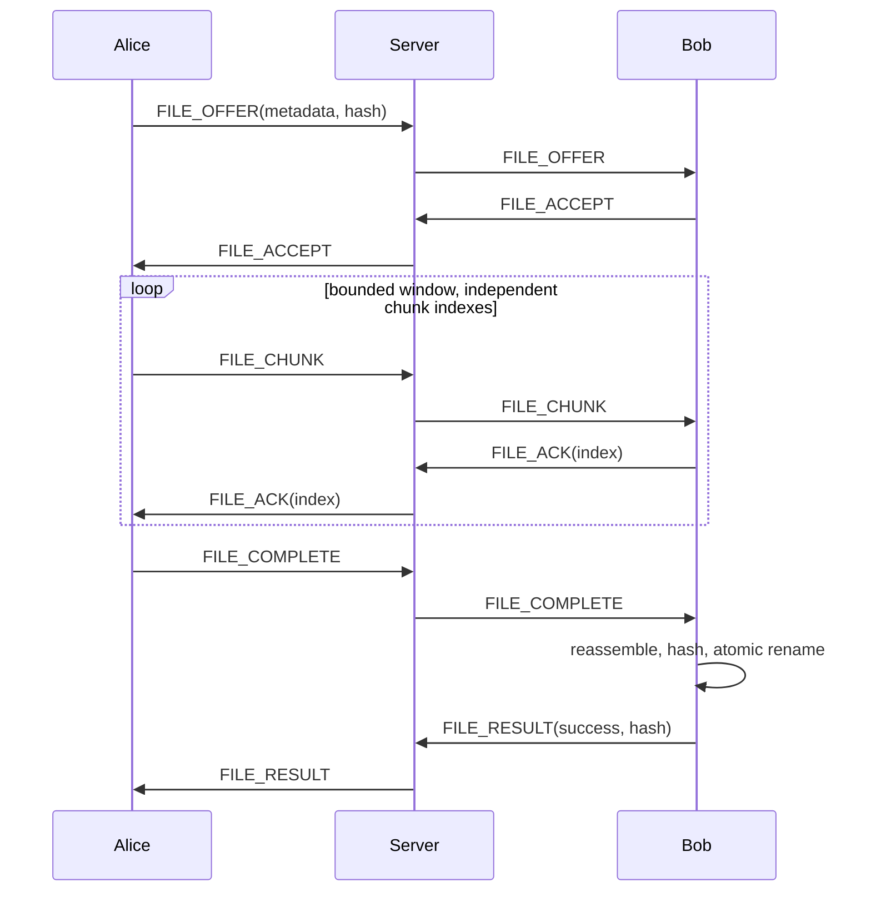

# Protocol and architecture decisions

The PDF's UDP streaming goal and milestone 6 take precedence over its general TCP-transfer example. Milestone 9 explicitly requests HTTP UI; HTTP is confined to a loopback standard-library bridge. No HTTP framework or WebSocket is used for distributed traffic.

## TCP control

A four-byte unsigned network-endian length precedes UTF-8 JSON, limited to 16384 bytes. TCP connection setup has a 5-second client timeout; subsequent HELLO/AUTH reads use a separate 30-second timeout, also used by the server waiting for AUTH. The Python client accepts connect_timeout/auth_timeout overrides; session and UDP timers are independent. HELLO version 2 carries the server's ephemeral X25519 public key and a random 12-byte challenge (hex). AUTH carries username, UDP port, client X25519 public key and an encrypted password (hex ciphertext with AES-GCM tag). The login cipher key is SHA256(session secret + `login-password-v2`); nonce is the challenge, and AAD is compact JSON `[username, udp_port]`. Each connection uses fresh ephemeral keys/challenge, so replaying an old AUTH fails. AUTH_OK carries a UUID session, server public key and UDP port. AUTH_ERROR rejects invalid credentials. Old handshake-v1 clients must upgrade; UDP wire format is unchanged.

Usernames match `[A-Za-z0-9_-]{1,24}` and must be unique among active sessions. Passwords contain 6-128 characters. First successful use creates an account; subsequent logins verify the saved password. The server stores only a random 16-byte salt and PBKDF2-HMAC-SHA256 hash (600,000 iterations) in SQLite; constant-time hash comparison verifies credentials. Accounts survive logout and server restart. Account lookup and insertion use short database critical sections; password hashing and verification run outside the lock. Concurrent creation uses atomic INSERT ON CONFLICT DO NOTHING. A losing registration re-reads and verifies the winning account, so a different password cannot overwrite it. This also handles separate account-store instances using the same SQLite file. Tests use isolated temporary stores. No password recovery or login rate limit is implemented. TCP EOF/logout removes the live session, not the account. UDP inactivity expires sessions after 15 seconds by default. READY synchronizes presence once the client has installed its key.

## UDP wire format

Each datagram is at most 1200 bytes. Header uses `!2sB16sQ`: magic `NC` (2 bytes), kind (1 byte: DATA=0 or ACK=1), session UUID (16 bytes), monotonically increasing packet counter (8 bytes). The remaining bytes are AES-GCM ciphertext with its 16-byte authentication tag. Datagram boundaries provide length; the fixed magic identifies protocol version 1. Header is authenticated additional data. Nonce is the counter encoded into 12 big-endian bytes. Independent directional keys prevent nonce collisions between client and server. Retransmission resends exactly the same ciphertext. New packets, including ACKs, consume new counters.

DATA plaintext is a JSON record. ACK plaintext is an eight-byte unsigned packet counter. DATA records are deduplicated using a bounded 8192-counter replay window. ACK is sent only after the dispatch queue accepts a new record. Invalid, oversized, unknown-session, wrong-source, malformed or unauthenticated packets are discarded. ACK replays cannot create new application events.

Application types: READY, USER_LIST (username entries and monotonic snapshot revision), HEARTBEAT, GLOBAL_MESSAGE, PRIVATE_MESSAGE, ERROR, FILE_OFFER, FILE_ACCEPT, FILE_ACK, FILE_CHUNK, FILE_COMPLETE, FILE_RESULT. Messages carry UUID id, text and recipient; server stamps authenticated sender and timestamp. Offers carry id/name/size/SHA-256/recipient. Chunks carry id/index/base64 data/recipient. Completion and result carry id; results add success and computed hash. FILE_ACK carries chunk index for end-to-end receiver credits. Session and packet counters identify the hop; file UUID plus sender identifies an independent file stream.

## Reliability, ordering and flow control

Each authenticated peer owns a selective-repeat send window, initially four packets, capped at 32. Missing packet ACKs cause selective timeout retransmission with 150 ms initial RTO and exponential backoff capped at two seconds. Twelve retries exhaust the connection. Backlogs cap at 256 records; dispatch queue caps at 8192. File senders keep at most 16 chunks ahead of receiver FILE_ACK credits, avoiding unlimited server relay buffering. Chunks are 512 raw bytes to leave room for base64, JSON metadata, encryption and the fixed header below 1200 bytes. File progress counts unique received bytes. Files are streamed to disk at indexed offsets, not accumulated in memory.

A file can complete before its final chunks due to packet reordering: completion is remembered until all bytes arrive. Duplicate chunks do not count twice. Incomplete files expire after 45 seconds and `.part` files are removed. Finalization requires matching SHA-256 and atomic rename. File names are reduced to a basename and prefixed with a random transfer UUID. Maximum accepted file size is 1 GiB; browser uploads cap at 32 MiB.

Records are delivered to independent handlers as they arrive: no connection-wide reorder wait. File ordering uses indexed random-access writes. Chat is message-oriented and arrival-ordered; it does not guarantee sender order across lost packets. All streams share a congestion window and dispatch worker, so complete bandwidth isolation is not claimed. UDP removes TCP-style in-order head-of-line blocking but cannot remove finite queue or scheduling contention.

## Educational CUBIC-inspired congestion controller

On each ACK, the window grows using the larger of additive growth and `0.4*(elapsed-K)^3 + Wmax`, where `K=(0.3*Wmax/0.4)^(1/3)`. Timeout reduces the window by factor 0.7, minimum two, resets the epoch and records retransmissions. This demonstrates cubic recovery and loss response; it is not a complete standards-conformant CUBIC or BBR implementation. It lacks RTT estimation, pacing, fast recovery and TCP fairness guarantees. `peer.cwnd`, `peer.pending`, `peer.backlog` and `peer.retransmissions` expose metrics for inspection.

## Security and trust

Password authentication establishes ownership of an existing username, while first login registers an unused name. X25519 ephemeral key agreement plus HKDF-SHA256 establishes a new 256-bit session secret. SHA-256 of secret plus distinct client/server labels yields separate AES-GCM traffic keys. Keys live only in memory and are never logged. Source IP and UDP port are bound at login. Encryption protects payload confidentiality and integrity against passive sniffing. Public headers expose session identifiers and traffic volume; TCP exposes usernames and public keys but carries passwords encrypted under a distinct login key. Browser-to-bridge HTTP stays loopback-only; the bridge necessarily handles the password transiently. No certificate or pinned server identity is used: an active man-in-the-middle can impersonate the server. The server decrypts routed data, so this is hop-by-hop encryption. Deploy only on a trusted LAN/VPN; do not expose to the Internet.

The HTTP bridge binds exclusively to 127.0.0.1, requires a random capability token in X-Token, verifies Host/Origin for API calls, rejects cross-origin requests and uses textContent for untrusted UI content. The token is printed in the URL fragment and removed from browser history after loading. Browser API events are session-scoped and bounded. Upload spools remain in the downloads directory for user inspection and can be deleted after transmission. Downloads are local files; no arbitrary file-read HTTP endpoint exists.

## Private conversation display

The Python client's local UI events include `conversation`, identifying the other participant. Incoming private messages, file offers and progress use the authenticated sender; local outgoing messages and locally generated file results use the recipient. File progress includes sender/recipient and a receiver-side FILE_RESULT identifies the local receiver as its sender. Transfer failures retain the counterpart and transfer ID, including timeout and offline-recipient errors.

The browser renders global messages only in Global chat. Private messages, offers, progress, file results and scoped errors render only when their `conversation` exactly matches the selected person. Unscoped connection errors go to the status notice, not every conversation's history. FILE_CHUNK/FILE_ACK and other internal transport events are never rendered as chat cards. Changing the selected channel re-filters the shared local event history without discarding other conversations. This display filter supplements server-side unicast routing; it does not replace routing isolation.

File ACK and accept records update client transport/application state only; they are not enqueued as UI events. The browser also ignores control records before applying its 1000-display-event history limit. Repeated PROGRESS events with the same transfer ID and conversation update the existing progress item rather than adding new history entries. This prevents a single transfer's acknowledgments or progress updates from evicting preceding messages such as the sender's local private-message echo. The general bounded-history policy still applies to actual chat and other visible events.

## Transfer and shutdown synchronization

The client-wide lock protects incoming/outgoing transfer maps, ACK lookup/update/removal, send-credit reads and upload-thread registration. Each incoming transfer owns a reentrant file lock and a closed flag. Chunk writes, completion hashing/finalization and partial-file disposal use that same file lock, so disposal cannot close a stream while it is being written or verified. Expiry snapshots transfer references under the client lock, releases it, then tries each file lock without blocking: busy transfers are revisited on a later heartbeat. The expiry condition is checked again under the file lock. Late records for a closed transfer are ignored. No client-wide lock is held while acquiring a file lock or hashing file content. Close prevents new transfers before snapshotting tasks and uses the same disposal path; repeated close calls are serialized.

The server marks itself stopping under the same lock used to register accepted connections and start their session threads. An accept that finishes after shutdown has begun closes its socket without creating a session. Authentication checks the stopping flag again before publishing a new session, even if hashing finished late. Presence/routing stop during shutdown. Peer removal acquires the transport lock and discards that peer's queued/pending packets. These measures cover the tested shutdown interleavings; uninterruptible work such as a running password hash is still allowed to finish, and thread joins retain their bounded wait.

## Dashboard access, transport counters and sender progress

The optional server dashboard binds exclusively to 127.0.0.1 and requires a random X-Token capability for /api/data, with Host/Origin checks and no cross-origin permission header. The printed URL carries the token in a fragment; the browser removes it from the address and retains it in tab sessionStorage. Logs describe routing metadata rather than chat text. Dashboard startup failure is nonfatal to the core server, and shutdown closes the dashboard before core cleanup.

Transport counters are snapshotted under the UDP transport lock. packets_in/bytes_in count socket receives; packets_out/bytes_out count successful sendto calls, including retransmitted copies and ACK datagrams. Byte counts include the application's 27-byte header and AES-GCM tag but exclude UDP/IP headers. ACK counters count authenticated ACK records received and generated ACK sends. Retransmissions have a separate cumulative counter. These counters reflect socket operations, not wire captures; application records/record bytes are separate server routing metrics.

Sender progress reads unique chunk indices acknowledged by the receiver. Byte accounting handles a partial final chunk even if it is acknowledged out of order. Upload waits for all FILE_ACKs (with a bounded wait) before queuing FILE_COMPLETE; it never reports successful transfer merely because all chunks entered a local queue. 100% acknowledged data is shown as received/awaiting verification until FILE_RESULT succeeds. A successful result also finalizes empty-file progress. Receiver progress still counts unique received bytes. SHA-256 and FILE_RESULT remain the integrity outcome, independent of percentage.
